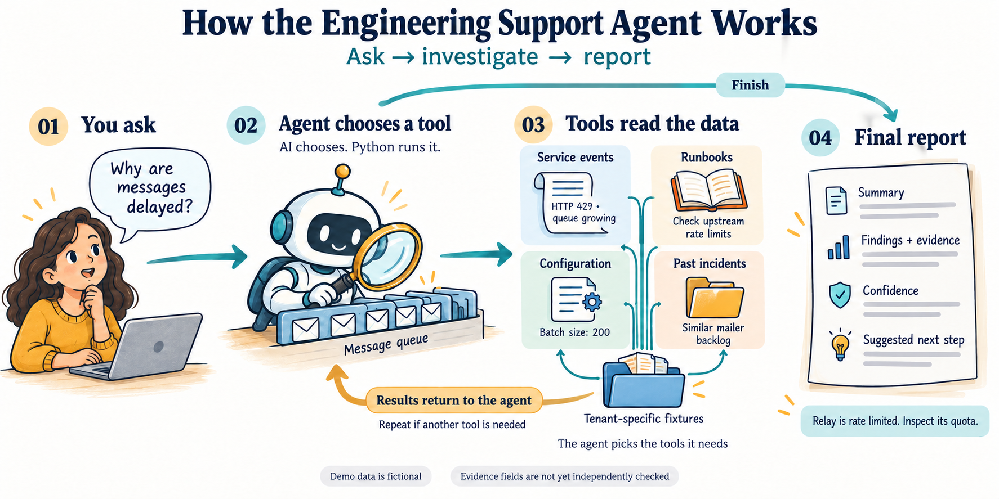

# Engineering Support Agent

A small Python agent that investigates fictional message-delivery incidents. It reads service events, runbooks, configuration fixtures, and previous incidents, then produces a structured report.

Built with LangChain and LangGraph. Includes a manual tool loop, streamed progress, optional MCP tools, and optional LangSmith tracing. Local prototype; no deployment or real customer data.



## What this project shows

- **Tool calling done two ways:** a hand-written agent loop and the same agent compiled with LangGraph, sharing one set of tools.
- **Tenant isolation outside the model:** tenant identity comes from session context, so the model cannot choose another tenant's data.
- **Structured output:** answers are validated against a `Report` schema with findings, evidence, confidence, and a next step.
- **MCP integration:** a local MCP server whose tools the agent discovers and calls at run time, tested against a real localhost server.
- **Honest failure handling:** a reproducible demo where the model ignores a tool error and answers wrongly, plus a documented list of what is not yet verified.
- **Reproducible checks:** 13 offline tests and CI that need no API key.

## Run without a key

Install [uv](https://docs.astral.sh/uv/getting-started/installation/) and use Python 3.12. From this repository:

```bash
uv sync --frozen
uv run --frozen python -m support_agent --offline
uv run --frozen pytest -q
```

Installation needs internet access. Offline demos use predetermined model messages while executing real tools and graph nodes. They demonstrate integration, not live-model reasoning or accuracy. Tests also start a temporary localhost MCP server, which is stopped afterward.

The default investigation reads mailer events, a delivery runbook, and a past incident. It reports HTTP 429 responses and a growing queue, then recommends inspecting the upstream quota. All data is fictional.

## How it works

| File | Purpose |
| --- | --- |
| `support_agent/domain.py` | Session context, model settings, report schema |
| `support_agent/tools.py` | Four read-only tools with hidden tenant context |
| `support_agent/fixtures.json` | Two fictional tenants; no real filesystem access |
| `support_agent/engine.py` | Manual loop, LangGraph agent, trace metadata |
| `support_agent/demo.py` | Predetermined model replies for offline runs |
| `support_agent/remote.py` | Two local MCP tools and asynchronous client |
| `support_agent/__main__.py` | CLI and streamed output |
| `tests/` | Tool contracts, loop, reports, CLI, and real localhost MCP checks |

The model chooses tools; Python executes them. Tenant identity comes from session context, outside model-visible arguments. LangGraph uses `ToolStrategy(Report)` for output validation. The manual loop returns messages rather than a structured report:

```bash
uv run --frozen python -m support_agent --offline --raw
```

## A failure you can reproduce

```bash
uv run --frozen python -m support_agent --offline --raw --unsupported
```

The CLI labels this **KNOWN FAILURE — NOT VERIFIED**. The model requests `mailer/setting.py`; the tool reports that it is missing and offers `mailer/settings.py`. The model still says the batch size is 20, although the actual fixture sets it to 200.

Exit code 0 means the loop finished, not that the answer is correct. This example deliberately exposes the gap between model completion and verified evidence.

## Live model

Copy `.env.example` to `.env`, add your endpoint's API key, and select a model supported by that endpoint:

```bash
uv run --frozen --env-file .env python -m support_agent "Why are messages delayed?"
```

The example uses an OpenAI-compatible OpenRouter endpoint. The `openai:` model prefix selects the installed client; the rest of the string is the endpoint's model ID. The application does not load `.env` automatically. Existing shell variables override `.env` values.

`SUPPORT_MODEL`, `SUPPORT_TEMPERATURE`, `SUPPORT_REPLY_TOKENS`, and `SUPPORT_REQUEST_TIMEOUT` configure the model, sampling, reply cap, and per-request timeout. Use temperature `none` if the selected model does not accept it. Live requests need network access and can incur charges.

## MCP

Start the fixture-backed server in one terminal:

```bash
uv run --frozen python -m support_agent.remote
```

In another terminal, run the credential-free integration demo:

```bash
uv run --frozen python -m support_agent --offline --mcp http://127.0.0.1:8876/mcp
```

For live model selection, omit `--offline` and add `--env-file .env`. The server exposes `deployment_flag` and `dependency_status`; both return fixed fictional values. Stop it with Ctrl+C. It has no authentication or tenant scoping and is intended only for localhost.

## Tracing and limits

Set `LANGSMITH_TRACING=true`, `LANGSMITH_API_KEY`, and `LANGSMITH_PROJECT` in `.env` to enable optional tracing. Traces can include model/tool inputs, outputs, tenant tags, and user metadata. Keep keys and trace exports out of Git.

Current limitations:

- Report schemas check output shape; evidence strings and confidence are not independently verified.
- Roles are context metadata, not enforced authorization; there is no authenticated caller boundary.
- Known resource misses return error observations. Unknown tools, malformed arguments, unexpected tool exceptions, and provider failures can stop the manual loop.
- Keyword search uses fixtures, not production retrieval.
- No conversation persistence, application retry policy, or whole-run cost/time budget. The manual loop stops after ten model turns; live replies and individual requests have configured limits.
- Offline transcripts are predetermined and do not measure model accuracy.
- Live provider calls have not been verified for this implementation.

